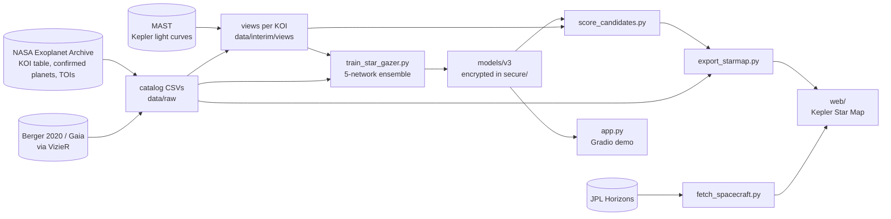

# Contributing

Thanks for taking a look. This is a one-person student project, but issues and pull requests are welcome.
For security problems, please follow [SECURITY.md](SECURITY.md) instead of opening an issue.

## How the pieces fit together



| Stage | Script | Output |
|---|---|---|
| Catalog check | `scripts/pipeline/check_catalog.py` | `data/interim/catalog_report.json` |
| Light-curve views | `scripts/pipeline/build_full_dataset.py` (`--candidates` for unlabelled KOIs) | `data/interim/views/` |
| Training | `scripts/pipeline/train_star_gazer.py` (resumes from checkpoints) | `models/v3/`, `results/v3/` |
| Candidate scores | `scripts/pipeline/score_candidates.py`, then `scripts/pipeline/scoreboard.py record` | `results/v3/candidates.csv`, public copies in `results/v3_public/` |
| Star map data | `scripts/starmap/export_starmap.py`, `fetch_spacecraft.py`, `make_sky_backdrop.py`, `make_sky_thumbs.py`, `make_ccd_footprint.py` | `web/data/`, `web/sky*` |
| Cross-validation | `scripts/pipeline/cross_validate.py` | `results/v3/cv_metrics.json` |
| Everything, in order | `scripts/pipeline/run_pipeline.py` (`--from <step>` to resume) | logs in `logs/pipeline/` |

The star map's data files are described in [docs/star-map/DATA_DICTIONARY.md](docs/star-map/DATA_DICTIONARY.md).

## Setting up

```powershell
py -3.12 -m venv .venv
.venv\Scripts\python -m pip install --require-hashes -r requirements-dev.lock
.venv\Scripts\python -m pip install --no-deps -e .
.venv\Scripts\python -m playwright install chromium      # browser tests
```

`requirements.txt` lists what the project needs; the `.lock` files pin exact, hash-checked versions
(regenerate them with `scripts/tools/lock_requirements.py` after changing a requirements file).

## Before opening a pull request

```powershell
.venv\Scripts\python -m ruff check scripts tests src app.py
.venv\Scripts\python -m mypy src/kepler_cnn scripts app.py
.venv\Scripts\python -m pytest -q
```

CI runs the same checks (plus the star map in headless Chromium).

## Working on the star map

- Edit `web/src/*.js`, never `web/starmap.js`: run `scripts/starmap/build_web.py` to rebuild it (a test fails if
  they drift apart). The page is one classic script so it also works opened straight from disk.
- The page has a strict Content Security Policy: no inline scripts or styles, no external scripts.
  Write values into the page through `esc()` / `fmt()`.
- Colours that carry meaning are checked for colour blindness in `tests/test_palette.py`.
- Browser checks live in `tests/browser/harness.js` and `tests/test_browser.py`.

## Data and honesty

- Map data comes only from official sources (NASA, ESA/Gaia, JPL, CDS surveys); never hand-type numbers.
- Star Gazer is an educational model, not a scientific classification. Keep claims in the docs and on
  the page measurable and sourced.
- The trained model is committed only encrypted; never commit `models/`, `results/v3/` or `.secrets/`.
