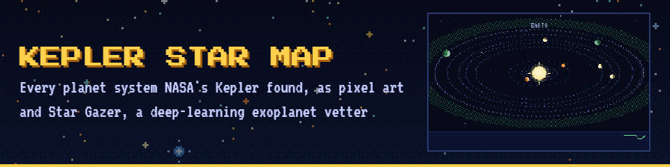
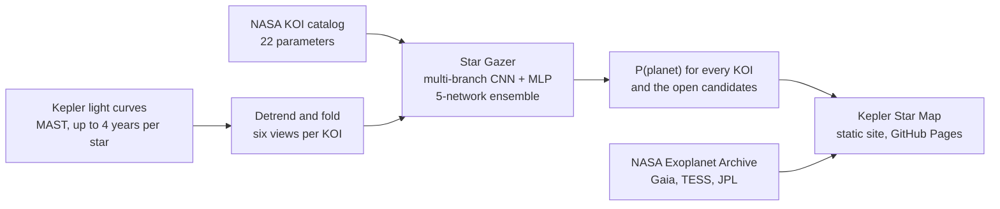
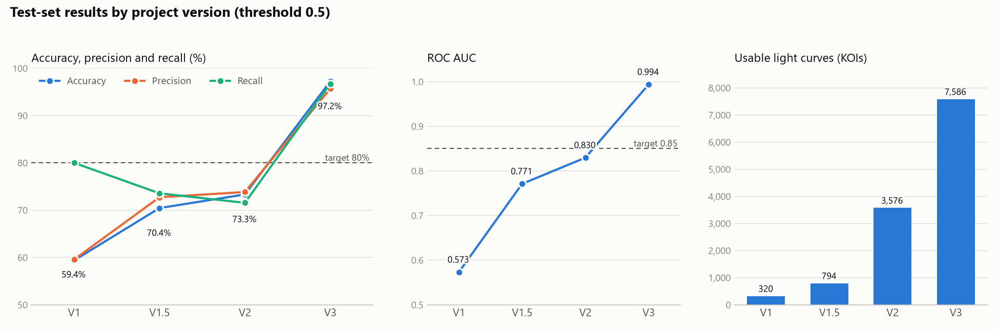
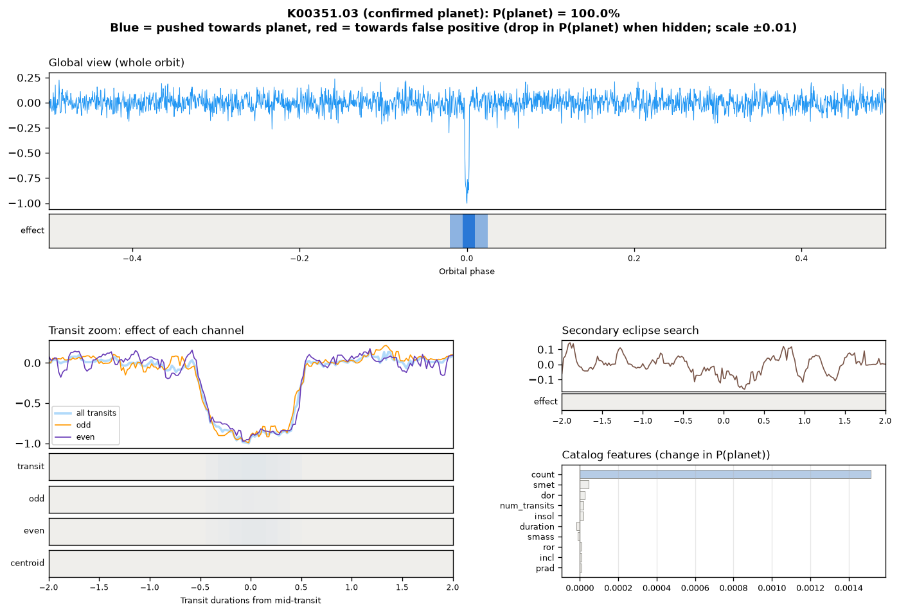
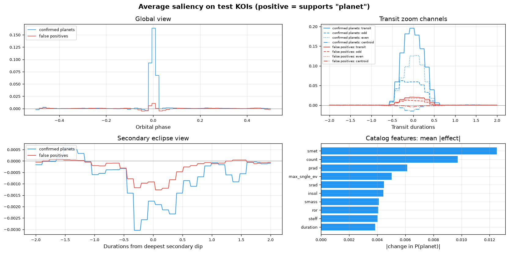
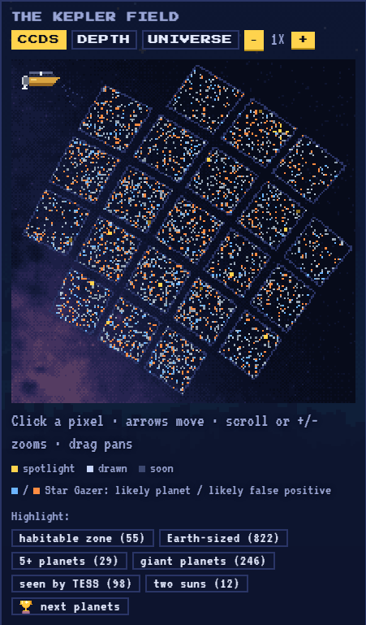
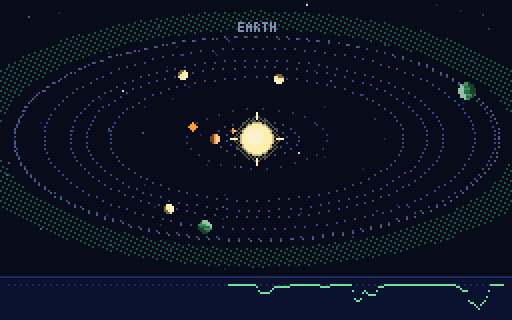
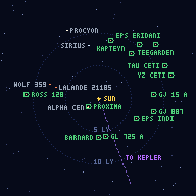
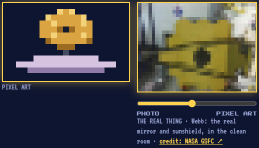

<p align="center">
  <a href="https://med27-coder.github.io/cv-project-kepler-exoplanet-detection-inventory/"></a>
</p>

<h1 align="center">Kepler Exoplanet Detection: from a 1D CNN to Star Gazer</h1>

<p align="center">
  A deep-learning vetter for NASA Kepler planet candidates, and a pixel-art map of every Kepler planet system.<br>
  Computer Vision, ITAI 1378 · a student portfolio project
</p>

<p align="center">
  <a href="https://med27-coder.github.io/cv-project-kepler-exoplanet-detection-inventory/"></a>
</p>

<p align="center">
  <a href="https://github.com/med27-coder/cv-project-kepler-exoplanet-detection-inventory/actions/workflows/tests.yml"></a>
  <a href="https://med27-coder.github.io/cv-project-kepler-exoplanet-detection-inventory/"></a>
  <a href="LICENSE"></a>
</p>

<p align="center">
  <a href="#at-a-glance">At a glance</a> ·
  <a href="#results-across-versions">Results</a> ·
  <a href="#the-kepler-star-map">Star map</a> ·
  <a href="#how-to-run-vs-code">How to run</a> ·
  <a href="docs/README.md">Docs</a> ·
  <a href="#licence-and-terms-of-use">Licence</a>
</p>

## At a glance

| Star Gazer accuracy | Area under ROC | Kepler systems mapped | The star map's game |
|:---:|:---:|:---:|:---:|
| **97.1% ± 0.4**<br><sub>5-fold cross-validation, held-out stars</sub> | **0.994**<br><sub>test split; ensemble accuracy 97.23%</sub> | **3,600+**<br><sub>every star with a planet or candidate</sub> | **29 easter eggs, 69 achievements**<br><sub>progress saved in your browser</sub> |

> **V3 "Star Gazer" (October 2026):** every Kepler quarter of every labelled star (~7,586 KOIs), AstroNet / ExoMiner-style views, and NASA catalog parameters in one hybrid network: **97.23% test accuracy, AUC 0.994**, up from 73.3% / 0.830 in V2. See [Results across versions](#results-across-versions) and [How to Run](#how-to-run-vs-code). Use is subject to the [Terms of Use](TERMS_OF_USE.md).

## Contents

1. [Overview](#overview): the problem, the solution and how it works
2. [Results across versions](#results-across-versions): metrics, ablation, cross-validation, explainability, candidates
3. [The Kepler Star Map](#the-kepler-star-map): the pixel-art site and its game
4. [Technical details](#technical-approach): approach, dataset, model architecture, data sources
5. [How to run](#how-to-run-vs-code), [repository structure](#repository-structure)
6. [Security](#security), [licence and terms of use](#licence-and-terms-of-use)
7. [Course record](#course-record): plan vs. implementation, weekly log, risks, AI usage


---

## Overview

### Problem

NASA's Kepler Space Telescope recorded brightness measurements for over 150,000 stars, generating thousands of potential exoplanet transit signals (Kepler Objects of Interest, or KOIs). Astronomers must distinguish genuine exoplanet transits from false positives caused by binary stars, instrument noise, or other astrophysical phenomena. Manual classification is time-consuming, subjective, and doesn't scale to the volume of data produced by modern space missions.

### Solution

An automated exoplanet vetting pipeline that outputs a probability (0–1) that a transit signal is a confirmed planet rather than a false positive. It evolved in four versions:

| Version | Input | Model | Result |
|---|---|---|---|
| **V1** (Mar 2026, Colab) | One Kepler quarter per star, folded to 201 points; 320 curves | 1D CNN (AstroNet-inspired) | 59.4% accuracy, AUC 0.573 |
| **V1.5** (May 2026, Colab) | Same, 794 curves; caching and parallel downloads | Same CNN | 70.4%, AUC 0.771 |
| **V2** (Oct 6, 2026, VS Code) | Same, 3,576 curves; local package, duplicates removed | Same CNN | 73.3%, AUC 0.830 |
| **V3 Star Gazer** (Oct 7, 2026) | **All quarters** per star; global, local, odd/even, secondary-eclipse and centroid views; NASA catalog parameters; ~7,586 KOIs | Multi-branch CNN + feature MLP | **97.23%, AUC 0.994** |

### How it works



---

## Results across versions

<picture>
  <source media="(prefers-color-scheme: dark)" srcset="results/version_progress_dark.png">
  
</picture>

*Regenerate with `.venv\Scripts\python scripts\experiments\plot_version_progress.py` (reads `results/v2/metrics.json` and `results/v3/metrics.json`).*

| Metric | Target | V1 | V1.5 | V2 | V3 Star Gazer |
|---|---|---|---|---|---|
| Test Accuracy | >80% | 59.38% | 70.44% | 73.32% | **97.23%** |
| Test AUC | >0.85 | 0.573 | 0.771 | 0.830 | **0.994** |
| Precision | >80% | 59.57% | 72.73% | 73.84% | **95.68%** |
| Recall | >80% | **80.00%** | 73.56% | 71.55% | **96.72%** |
| Prediction speed | <1s per curve | **7.4 ms** | **7.4 ms** | **9.0 ms** | **under 1 s** (after a one-time ~10 s download of the star's light curves) |
| Test set size | — | 64 | 159 | 716 | 1,517 KOIs on held-out stars |

All numbers are on a held-out test set at the 0.5 decision threshold. Bold: meets the project's target.

**How to read the jump to V3.** Three things changed at once, and the ablation below separates them:

1. **All quarters instead of one.** V1–V2 folded ~90 days of data, so a planet with a long period showed one or two transits buried in noise (Kepler-90 g, P = 210 d, could not be folded at all). V3 stitches up to 18 quarters (~4 years), so every transit is averaged in.
2. **Views that show what a false positive looks like.** Odd- vs even-transit depth, a secondary eclipse and a centroid shift are the classic signatures of eclipsing binaries, which are the most common false positives. V1–V2 could not see any of them.
3. **NASA catalog parameters** (period, duration, depth, planet radius, stellar properties…). The columns that encode NASA's own decision (dispositions, `koi_score`, `koi_fpflag_*`) are never used as inputs.

Two caveats keep the comparison honest. V3 uses every labelled KOI, so its classes are not balanced like V1–V2's 50/50 samples (about 64% are false positives). It also splits **by star**: no star contributes KOIs to both training and test.

### V3 ablation: which inputs matter?

Every variant was trained on the same star-grouped split (4,855 train / 1,214 validation / 1,517 test KOIs):

| Variant | Inputs | Test accuracy | Test AUC |
|---|---|---|---|
| Global + local transit view (AstroNet baseline) | light curve | 93.21% | 0.975 |
| All light-curve views | + odd/even, centroid, secondary eclipse | 96.37% | 0.988 |
| Catalog features only | 22 NASA catalog parameters, no light curve | 92.35% | 0.978 |
| **Star Gazer** (final model) | all views + catalog parameters | **97.23%** | **0.994** |
| Star Gazer + NASA diagnostics | adds NASA's Robovetter statistics (partly circular, ablation only) | 96.64% | 0.994 |

**Reading the ablation.** The light-curve views carry most of the signal: the odd/even, centroid and secondary-eclipse views lift the AstroNet-style baseline from 93.2% to 96.4%. The 22 catalog numbers alone reach 92.4%, and combining both gives the best model. Two notes keep this fair. First, Star Gazer's row is the 5-network ensemble while the other rows are single networks; Star Gazer's own single networks score 96.5–97.4%, so roughly half a point of its lead comes from averaging. Second, single-split differences move by about ±0.4 points from seed to seed, so only gaps of about a point or more mean anything. Adding NASA's own Robovetter diagnostics doesn't help (96.6%, same AUC): the light curves already hold that information. Feature ablations are in [docs/star-gazer/EXPERIMENTS_V3.md](docs/star-gazer/EXPERIMENTS_V3.md): adding Gaia stellar properties lands within the normal seed-to-seed range (no clear gain), and removing `koi_count` barely changes anything, so the model doesn't lean on that flagged input.

The decision threshold that maximises validation accuracy is 0.70. At that threshold the test accuracy is 97.63%. The web app uses this threshold.

The final model is an **ensemble of 5 networks** (same architecture, different random seeds) whose probabilities are averaged. That makes it more stable and better calibrated: its Brier score is 0.021 (0 is perfect), and the calibration curve is in `results/v3/evaluation.png`.

### Cross-validation: how stable is the result?

A single test split can be lucky. `scripts/pipeline/cross_validate.py` repeats training 5 times so that every star is in the test set exactly once (still grouped by star):

| Variant | Accuracy (mean ± std) | AUC (mean ± std) |
|---|---|---|
| Global + local view (AstroNet baseline) | 92.95% ± 0.60 | 0.976 ± 0.004 |
| **Star Gazer** (single network) | 97.09% ± 0.42 | 0.993 ± 0.002 |

**Main estimate:** a single Star Gazer network scores **97.1% ± 0.4** across the 5 folds, in line with the headline split (fold 1 *is* the headline split; the other four are new). The 5-network ensemble adds roughly half a point on top. Cross-validation here trains single networks, not the ensemble.

**Independently audited:** a separate review rebuilt the split, recomputed every metric and checked for leakage, test-set tuning and repeated re-runs; verdict, caveats and baselines in [docs/star-gazer/AUDIT_V3.md](docs/star-gazer/AUDIT_V3.md). In short: genuine (95% interval for accuracy ≈ 96.4–98.1%), measured on already-resolved KOIs, not on brand-new signals.

### Comparison with published models

| Model | Data and labels | Result |
|---|---|---|
| AstroNet ([Shallue & Vanderburg 2018](https://arxiv.org/abs/1712.05044)) | Kepler DR24 TCEs, Autovetter labels; 1,523 test TCEs | AUC 0.988, precision 0.93, recall 0.95 |
| ExoMiner ([Valizadegan et al. 2022](https://arxiv.org/abs/2111.10009)) | Kepler Q1–Q17 DR25 TCEs, cross-validated | Recall 0.936 at precision 0.99 |
| **Star Gazer (this project)** | Kepler cumulative KOI table, CONFIRMED vs FALSE POSITIVE; 1,517 test KOIs on held-out stars | AUC 0.994, precision 95.68%, recall 96.72%; recall 0.907 at precision 0.99 |

The label sets differ (TCEs vs KOIs, Autovetter vs archive dispositions), so this is context, not a head-to-head ranking. Star Gazer also uses catalog parameters, which AstroNet does not.

### Explainability: what does the model look at?

`src/kepler_cnn/saliency.py` hides one small window of a view at a time, or one catalog feature, re-runs the model and records how much P(planet) drops. Blue regions pushed the score towards "planet", red towards "false positive". The web app shows this for any KOI ("Explain this prediction").





**What the saliency shows.** On average the evidence for "planet" sits in the transit itself: the dip in the global view and the transit window in the close-up, with the odd- and even-transit channels both supporting it (a planet's transits are identical; an eclipsing binary's alternate). The centroid channel argues slightly against "planet" when it moves, as it should. The secondary-eclipse view contributes little on average, about 1/100 of the transit's effect, because only a minority of false positives show one. Among the catalog numbers the largest effects come from the star's metallicity and the number of KOIs on the star. The independent audit flags the second as partly reflecting how NASA confirmed planets (multi-planet systems were validated in bulk). False positives also more often carry default stellar values, so part of the metallicity signal may be the same kind of bookkeeping artefact rather than astrophysics. The `no-koi-count` ablation measures it.

**Through another telescope (TESS).** For 40 confirmed Kepler planets that NASA's TESS satellite saw again, views built from TESS light curves give the same verdict as Kepler's own for 85% (7 of 7 for planets never seen in training). It also exposed a weakness: these are mostly giant planets with deep transits, and even with Kepler data only 75% of them are called planets, well below the 96.7% recall on the full test set. Details: [docs/star-gazer/EXPERIMENTS_V3.md](docs/star-gazer/EXPERIMENTS_V3.md).

**Where it succeeds and fails.** Broken down by planet size, signal strength, period and star ([docs/star-gazer/DATA_ANALYSIS.md](docs/star-gazer/DATA_ANALYSIS.md)), Star Gazer finds 96–100% of small planets (under 4 Earth radii) but only 1 of the 7 real giant planets above 15 Earth radii in the test set, because nearly every KOI that big is an eclipsing binary. That is the main target for V4.

### Scoring the unlabelled candidates

NASA still lists 1,977 KOIs as CANDIDATE (neither confirmed nor ruled out). `scripts/pipeline/score_candidates.py` scores the 1,976 that have usable views: **737 (37%)** score above the threshold, and Star Gazer agrees with NASA's own Robovetter score (`koi_score`, never a model input) on 61% of them. The ten most planet-like:

| KOI | Period (d) | Radius (R⊕) | Star Gazer P(planet) | NASA `koi_score` |
|---|---|---|---|---|
| K03444.01 | 12.67 | 0.76 | 0.999 | 1.000 |
| K01590.01 | 12.89 | 1.93 | 0.999 | 0.998 |
| K04032.05 | 7.24 | 0.82 | 0.999 | 0.790 |
| K01053.02 | 46.25 | 2.46 | 0.999 | 0.908 |
| K02926.05 | 75.73 | 3.47 | 0.999 | 0.889 |
| K01151.05 | 21.72 | 0.80 | 0.998 | 0.795 |
| K01590.03 | 4.75 | 1.30 | 0.998 | 0.996 |
| K02449.01 | 53.36 | 3.41 | 0.998 | 1.000 |
| K06132.01 | 33.32 | 13.00 | 0.998 | 0.996 |
| K01628.03 | 37.84 | 1.76 | 0.998 | 0.000 |

> [!NOTE]
> These are model outputs for an educational project, **not** discoveries or classifications (see the [Terms of Use](TERMS_OF_USE.md)).

---

## The Kepler Star Map

**[Open the star map](https://med27-coder.github.io/cv-project-kepler-exoplanet-detection-inventory/)** (or open `web/index.html` straight from disk).

<table>
  <tr>
    <td width="40%" align="center"></td>
    <td width="60%" align="center"></td>
  </tr>
  <tr>
    <td align="center"><sub>Every star Kepler found a planet or candidate around, in its 21 camera squares</sub></td>
    <td align="center"><sub>Pick one: its planets orbit, and the light curve dips as each one crosses the star</sub></td>
  </tr>
  <tr>
    <td align="center"></td>
    <td align="center"></td>
  </tr>
  <tr>
    <td align="center"><sub>UNIVERSE: zoom out sector by sector, from Kepler's field to the oldest light</sub></td>
    <td align="center"><sub>The Galleria: each easter egg's pixel art next to the real photo, with a slider between them</sub></td>
  </tr>
</table>

<sub>Pictures made by <code>scripts/starmap/make_readme_media.py</code> from the live page.</sub>

A pixel map of the Kepler field with every star that has a planet or planet candidate (3,600+, including the
planets Kepler found outside its usual candidate list, like Kepler-16 b, a real "Tatooine" with two suns). Search a system (`Kepler-90`, `KOI-351`, `K00351.01` or a Kepler ID), click a pixel or use the arrow keys, and the system pops up as pixel art: a limb-darkened star coloured by temperature, shaded planets sized by radius and coloured by temperature (banded giants, icy caps, lava worlds), eccentric orbits that follow Kepler's equation, an approximate habitable zone, a companion star in multi-star systems, and a live light curve that dips whenever a planet crosses its star, the way Kepler found them. Each system can be zoomed and dragged, fitted to show its whole habitable zone, or switched to true scale (real distances and sizes, with a scale bar and Earth's orbit for comparison). Behind the map is the real Milky Way (ESA Gaia DR3); each system has real sky photos (DSS2, Pan-STARRS, 2MASS infrared), star facts (mass, age, metals, distance), TESS re-detections, and a table with masses, orbits, sunlight and discovery years. Systems whose only planets are unscored candidates show *"Soon to cross the stars"*; once Star Gazer has scored them, they are drawn and coloured by its verdict.

The **UNIVERSE** button zooms out in six sectors (◀ ▶ or the arrow keys): Kepler's field, the Sun's neighbourhood (every star with confirmed planets within 13 light-years, from NASA's table), the Milky Way, the Local Group (real galaxy distances, McConnachie 2012), Laniakea and the observable universe, each with its sources.

**It's also a game.** The gear button opens the **Galleria**: 38 hidden easter eggs to find by name (each shows its
pixel art next to the real NASA photo, with a slider that turns one into the other, plus fun facts and why it was
hidden), 79 achievements with trophies by difficulty, set badges and a constellation per group, and a hologram
close-up of every trophy. Some eggs open their own animated scenes (the rovers at work on Mars and the Moon, a farm on Mars, the
dwarf planets), comets and asteroids cross the map to be caught, and a lost astronaut collects a wardrobe of rare
outfits. Your achievements grow **your star** in the page header, from stardust to a black hole for the final
mission (open every system on the map). Visitors can **make their own predictions** on candidates (planet or
not?), scored when NASA rules, and there's a **daily mystery star**. Progress stays in your own browser (no
accounts, no tracking) and can be backed up to a file. A first-visit tour shows the way around, and the antenna
on the page's edge holds a note from the maker and every update, version by version
([CHANGELOG.md](CHANGELOG.md)); each release is tagged on GitHub.

Everything is drawn from numbers on small canvases (about 1.8 MB of data for all systems, loaded in pieces as
you open them) and hosted free on GitHub Pages. The data comes from the NASA Exoplanet Archive (KOI,
confirmed-planet, Kepler-names and TESS TOI tables; NASA's rulings on candidates are recorded every month),
Berger et al. 2020 (Gaia stellar properties), NASA JPL Horizons (spacecraft positions), NASA's Image and Video
Library (Galleria photos) and Star Gazer's candidate scores:

```powershell
.venv\Scripts\python scripts\starmap\export_starmap.py      # -> web/data/systems.js
.venv\Scripts\python scripts\starmap\make_sky_backdrop.py   # -> web/sky.png (only if the star list changes)
```

One familiar system is hidden in the search even though it isn't in the Kepler field. Hint: every star on the map is seen from there. There are many more: the Galleria shows each one as a silhouette with a clue. (Spoilers: [docs/star-map/EASTER_EGGS.md](docs/star-map/EASTER_EGGS.md).)

Roadmap: [docs/star-map/STARMAP_PLAN.md](docs/star-map/STARMAP_PLAN.md). The game's design: [docs/star-map/STAR_GAZER_MISSION.md](docs/star-map/STAR_GAZER_MISSION.md). Data files: [docs/star-map/DATA_DICTIONARY.md](docs/star-map/DATA_DICTIONARY.md). All documentation: [docs/README.md](docs/README.md). Contributing (architecture, setup, checks): [CONTRIBUTING.md](CONTRIBUTING.md).

---

## Technical Approach

| Field | V1 – V2 | V3 Star Gazer |
|---|---|---|
| **CV technique** | Binary time-series classification | Multi-view time-series classification + tabular features |
| **Model** | 1D CNN — 4 conv blocks (16→32→64→128) + dense head | AstroNet global/local towers + secondary-eclipse tower + feature MLP, merged by a dense head |
| **Framework** | TensorFlow 2.x / Keras, scikit-learn | Same; `lightkurve` + direct MAST downloads; `cryptography` for private artifacts |
| **Why** | 1D CNNs capture local patterns in sequential flux data (AstroNet) | Each view targets one false-positive mechanism (ExoMiner); catalog parameters add physical context the light curve alone lacks |

---

## Dataset

| Field | Details |
|---|---|
| **Source** | NASA Exoplanet Archive (KOI cumulative table) + MAST (Kepler long-cadence light curves) |
| **Labels** | Pre-labeled by NASA: `CONFIRMED` (class 1) vs `FALSE POSITIVE` (class 0) |
| **Size (V1)** | 400 light curves sampled (200 per class) → 320 usable after filtering |
| **Size (V1.5)** | 1,000 light curves sampled (500 per class) → 794 usable after filtering |
| **Size (V2)** | 4,000 light curves sampled (2,000 per class) → 3,576 unique usable curves (1,771 planets, 1,805 false positives) |
| **Size (V3)** | **All** 7,587 labelled KOIs → 7,586 with usable views (2,748 planets, 4,838 false positives) on 6,640 stars |
| **Quality filters (V1–V2)** | Download success, NaN rate <10%, signal variance check, final NaN sanitisation |
| **Processing (V3)** | Quality-flagged cadences removed, per-quarter normalisation, all known transits masked, Savitzky–Golay detrending, 3σ upward-outlier clipping, then six binned views per KOI ([details](data/README.md#v3-star-gazer-data)) |
| **NASA Archive** | https://exoplanetarchive.ipac.caltech.edu |
| **MAST** | https://mast.stsci.edu/portal/Mashup/Clients/Mast/Portal.html |
| **lightkurve docs** | https://docs.lightkurve.org |

> [!NOTE]
> No data files are committed to this repository. Light curves are streamed from NASA MAST on demand and cached locally under `data/`. See [data/README.md](data/README.md).

---

## Model Architecture

**V1 – V2: single-view 1D CNN**

```
Input (201, 1)
    ↓
4 × [Conv1D(k=5) → BatchNorm → ReLU → MaxPooling1D(2)]   filters 16 → 32 → 64 → 128
    ↓
Flatten → Dense(512) → Dropout(0.5) → Dense(256) → Dropout(0.3)
    ↓
Dense(1, sigmoid) → Planet probability (0–1)
```

**V3: Star Gazer**

```
global view (2001, 1)            local views (201, 4)                secondary view (201, 1)    catalog features (22)
whole orbit, phase-folded        transit / odd / even / centroid     deepest off-transit dip    period, depth, radius, star…
        ↓                                ↓                                   ↓                          ↓
5 × [2×Conv1D(k=5) → MaxPool]    2 × [2×Conv1D(k=5) → MaxPool]       2 × [Conv1D → MaxPool]     Dense(64) → Dense(64)
filters 16 → 256                 filters 16 → 32                     filters 8 → 16
        └────────────────────────────────┴──────────────── concatenate ──────┴──────────────────────────┘
                                                              ↓
                                Dense(512) → Dense(256) → Dense(128), each + Dropout(0.3)
                                                              ↓
                                                Dense(1, sigmoid) → P(planet)
```

**Training config:**

| | V1 – V2 | V3 |
|---|---|---|
| Optimizer | Adam (lr 1e-4), ReduceLROnPlateau (×0.5, patience 4) | Same |
| Loss | Binary cross-entropy | Binary cross-entropy with class weights |
| Epochs | Max 60, EarlyStopping (patience 8, val AUC) | Same |
| Batch size | 32 | 64 |
| Augmentation | — | Random time reversal of the views (AstroNet) |
| Split | 68 / 12 / 20, stratified by label | ~64 / 16 / 20, stratified **and grouped by star** |
| Threshold | 0.5 | 0.5 reported; best-validation threshold saved for the app |

---

## Data Sources

No data files are committed to this repository.

| # | Dataset | Source | How It's Loaded |
|---|---|---|---|
| 1 | NASA KOI Cumulative Table (V1–V2 columns) | [NASA Exoplanet Archive TAP API](https://exoplanetarchive.ipac.caltech.edu/TAP/sync?query=select+kepid,kepoi_name,koi_disposition,koi_period,koi_time0bk+from+cumulative&format=csv) | `kepler_cnn.data.load_catalog()` |
| 2 | NASA KOI Cumulative Table (all columns, V3) | [NASA Exoplanet Archive TAP API](https://exoplanetarchive.ipac.caltech.edu/TAP/sync?query=select+*+from+cumulative&format=csv) | `scripts/pipeline/build_full_dataset.py` → `data/raw/koi_cumulative_full.csv` |
| 3 | Kepler Light Curves | [NASA MAST Archive](https://mast.stsci.edu/) via `lightkurve` (V1–V2) and direct MAST file downloads (V3) | `kepler_cnn.data` (V1–V2), `kepler_cnn.views` (V3) |
| 4 | Confirmed planets in the Kepler field (`pscomppars`): masses, distances, discovery years, planets found by other methods | [NASA Exoplanet Archive TAP API](https://exoplanetarchive.ipac.caltech.edu/) | `scripts/starmap/export_starmap.py` → `data/raw/ps_kepler_planets.csv` (star map) |
| 5 | Gaia-based stellar properties for 186,301 Kepler stars ([Berger et al. 2020](https://ui.adsabs.harvard.edu/abs/2020AJ....159..280B)) | [VizieR J/AJ/159/280](https://vizier.cds.unistra.fr/viz-bin/VizieR?-source=J/AJ/159/280) | `scripts/data/fetch_extra_data.py`; star mass, age and metals on the star map (feature experiment planned) |
| 6 | Sky photos around each star (DSS2, Pan-STARRS1, 2MASS) | [CDS hips2fits](https://alasky.cds.unistra.fr/hips-image-services/hips2fits) | Fetched live by the star map, 40×40 pixels; nothing stored |
| 7 | TESS Objects of Interest in the Kepler field | [NASA Exoplanet Archive TAP API](https://exoplanetarchive.ipac.caltech.edu/) (`toi` table) | `scripts/starmap/export_starmap.py` → `data/raw/toi_kepler_field.csv` (star map) |
| 8 | Milky Way colour map (ESA Gaia DR3) | [CDS hips2fits](https://alasky.cds.unistra.fr/hips-image-services/hips2fits) | `scripts/starmap/make_sky_backdrop.py` → `web/sky.png` (star map background) |

---

## How to Run (VS Code)

**Requirements:** VS Code with the *Python* and *Jupyter* extensions (recommended automatically when you open the folder), and **64-bit x64 Python 3.10–3.12**.

> [!TIP]
> On Windows-on-ARM laptops, use the x64 Python build. TensorFlow has no native ARM64 Windows wheels, but the x64 build runs fine under emulation. No GPU is needed.

1. **Create the environment** (VS Code terminal, from the repo root):
   ```powershell
   py -3.12 -m venv .venv
   .venv\Scripts\python -m pip install -r requirements.txt
   ```
   This also installs the project's own package (`src/kepler_cnn`) in editable mode, so the scripts, app and notebooks can import it.
2. **Accept the [Terms of Use](TERMS_OF_USE.md).** The notebooks ask in their first cell. Scripts prompt in the terminal, or you can set `KEPLER_ACCEPT_TERMS=1` for batch runs.

### V3 Star Gazer

3. **Build the dataset** (a few hours; resumable, so you can stop and re-run):
   ```powershell
   .venv\Scripts\python scripts\pipeline\build_full_dataset.py            # add --limit 20 for a quick test
   ```
4. **Train** all ablation variants and the final 5-network ensemble (CPU, a few hours):
   ```powershell
   .venv\Scripts\python scripts\pipeline\train_star_gazer.py --diagnostics --ensemble 5
   ```
   This writes `models/v3/` and `results/v3/` (metrics, figures, saliency maps, test predictions). Use `--variants hybrid --quick` for a 5-epoch plumbing test.
5. **(Optional) Cross-validate and score the candidates:**
   ```powershell
   .venv\Scripts\python scripts\pipeline\cross_validate.py                      # 5 folds, a few hours
   .venv\Scripts\python scripts\pipeline\build_full_dataset.py --candidates     # views for the CANDIDATE KOIs
   .venv\Scripts\python scripts\pipeline\score_candidates.py                    # -> results/v3/candidates.csv
   ```
6. **Explore** `notebooks/Exoplanet_Detection_V3_StarGazer.ipynb` (`.venv` kernel): views, features, evaluation, ablation and predictions.
7. **Web demo:**
   ```powershell
   .venv\Scripts\python app.py              # Star Gazer at http://127.0.0.1:7860
   .venv\Scripts\python app.py --model v2   # the V2 CNN
   ```
   Or use **Run and Debug ▸ "Gradio app (local)"**. Add `--share` for a temporary public link (see Terms §6). Tick **"Explain this prediction"** for a saliency map. The app refuses a model trained on an older view recipe than the current code builds; retrain it, or start the app with `--allow-stale`.
8. **(Optional) Host the demo for free on Hugging Face Spaces** (CPU basic tier, no subscription): `scripts\tools\make_hf_space.py` builds `build/hf_space/`. Its docstring lists the upload commands and the `STAR_GAZER_KEY` secret to set. The model is uploaded only in encrypted form.

**Using the committed V3 model instead of retraining:** the trained model and detailed results are stored encrypted (AES-256-GCM) in `secure/`: parts of up to 90 MB (GitHub's file limit is 100 MB), each authenticated together with its position in the bundle, plus a `MANIFEST.json` with every part's SHA-256. With the key (`.secrets/star_gazer.key` or the `STAR_GAZER_KEY` environment variable):
```powershell
.venv\Scripts\python scripts\tools\secure_artifacts.py unlock    # -> models/v3 + results/v3
```
Without the key, retrain with step 4. After retraining, `secure_artifacts.py lock` re-encrypts. Other commands: `verify` (check the parts against the manifest), `rotate` (re-encrypt with a new key), `protect` (add a passphrase to the key file) and `status`.

### V2 (single-quarter CNN)

1. **(Optional) Reuse your Colab files.** Download the `exoplanet_checkpoints` folder from Google Drive, then:
   ```powershell
   .venv\Scripts\python scripts\data\import_colab_checkpoints.py "C:\path\to\exoplanet_checkpoints"
   ```
   - `X_raw.npy` + `y_raw.npy` become the **v2** dataset, with duplicates removed.
   - `X_lightcurves.npy`, `y_labels.npy` and `exoplanet_cnn_model.keras` become the **v1_5** dataset and model.
   - `nasa_koi_catalog.csv` goes to `data/raw/`.
2. **Open** `notebooks/Exoplanet_Detection_V2.ipynb`, select the **`.venv`** kernel, set `ACCEPT_TERMS = True` in Cell 0.2, and choose **Run All**.
   - Without cached data, Step 4 downloads about 1,000 light curves from MAST (10–30 min), resuming if interrupted.
   - `DATASET = 'v2'` (default) trains in about a minute on CPU, then loads from `models/v2/`. Set `RETRAIN = True` to train again.
   - `DATASET = 'v1_5'` loads the V1.5 Colab model and reproduces its reported metrics.

**Tests:** `.venv\Scripts\python -m pytest`

---

## Repository Structure

<details>
<summary>The folder tree, with what each part does</summary>

```
cv-project-kepler-exoplanet-detection-inventory/
├── README.md                     ← You are here
├── SECURITY.md                   ← Security measures and how to report a problem
├── TERMS_OF_USE.md               ← Terms of Use (accepted in notebooks / scripts / app)
├── LICENSE, NOTICE.md           ← PolyForm Noncommercial 1.0.0; third-party material and its terms
├── requirements.txt              ← Local (VS Code) dependencies
├── pyproject.toml                ← `pip install -e .` + pytest config
├── app.py                        ← Gradio web demo: Star Gazer, V2 or V1.5 (local by default)
├── .vscode/                      ← Interpreter, notebook root, launch configs, recommended extensions
├── .github/                      ← CI: tests, star map deploy, CodeQL, dependency audit, Dependabot
├── cspell.json                   ← Project words for the VS Code spell checker
├── src/kepler_cnn/
│   ├── config.py                 ← Paths & constants (single source of truth)
│   ├── data.py                   ← V1–V2: catalog, download/fold, quality filters, dataset cache
│   ├── model.py                  ← V1–V2: 1D CNN, training, evaluation, prediction
│   ├── views.py                  ← V3: all-quarter download, detrending, the six views
│   ├── star_gazer.py             ← V3: features, star-grouped split, hybrid model, train/evaluate
│   ├── training.py               ← V3: training variants, checkpoints, scoring (shared by the scripts)
│   ├── saliency.py               ← V3: occlusion saliency (what drove a prediction)
│   ├── giants.py                 ← V4 (Colossus): giant-planet physics features and the specialist
│   ├── runtime.py                ← Low CPU priority + TensorFlow thread limits for long runs
│   ├── plots.py                  ← All figures
│   └── terms.py                  ← Terms of Use acceptance gate
├── scripts/                      ← Grouped by job; index in scripts/README.md
│   ├── pipeline/                 ← V3: build views, train, cross-validate, score candidates, scoreboard (run_pipeline.py runs them all)
│   ├── starmap/                  ← Star map data and art: export (NASA tables), sky backdrop, spacecraft, Earth map, reference photos, pixel-art exports
│   ├── experiments/              ← Ablations, TESS transfer, error analysis, the cross-version chart
│   ├── data/                     ← Extra datasets, NASA schema check, Colab import
│   └── tools/                    ← Encrypted model (secure_artifacts.py), hash-locked dependencies, Hugging Face demo
├── notebooks/
│   ├── Exoplanet_Detection_V3_StarGazer.ipynb  ← Current notebook (V3)
│   ├── Exoplanet_Detection_V2.ipynb            ← V2 notebook (VS Code)
│   └── archive_colab/                          ← Original Colab notebooks (V1, V1.5, V2 draft, exploration), unchanged
├── web/                          ← Pixel star map (static site, deployed by .github/workflows/pages.yml)
├── pixel-art/                    ← The map's sprites enlarged (solar-system/, spacecraft/, icons/), concept art (emblems/, concepts/), official reference photos (references/)
├── tests/                        ← pytest suite (run on every push by .github/workflows/tests.yml)
├── data/                         ← Local data cache (git-ignored); see data/README.md
├── models/                       ← models/<version>/ (git-ignored)
├── secure/                       ← star_gazer_v3.partNN.enc (encrypted model + results) + MANIFEST.json
├── results/
│   ├── version_progress*.png     ← Cross-version chart (light / dark)
│   ├── v1_5/                     ← Figures from the V1.5 Colab run (reported metrics)
│   ├── v2/                       ← Figures written by the V2 notebook
│   ├── v3/                       ← Written by the V3 scripts (git-ignored; committed encrypted)
│   └── v3_public/                ← A few V3 figures shown in this README
└── docs/
    ├── README.md                 ← Index of all docs
    ├── star-gazer/               ← The model: V3 audit, data analysis, experiments; V4 (Colossus) pre-registrations and results
    ├── star-map/                 ← The site: data dictionary, easter eggs (spoilers), the game's design, roadmap
    ├── plans/                    ← Plans for upcoming features (plans/README.md is the planner)
    ├── media/                    ← README banner, screenshots and link previews (generated)
    ├── IMPROVEMENTS.md           ← Project-wide backlog
    └── presentation/             ← Portfolio slides (.pptx) and the PDF
```

</details>

---

## Security

[](https://github.com/med27-coder/cv-project-kepler-exoplanet-detection-inventory/actions/workflows/codeql.yml) [](https://github.com/med27-coder/cv-project-kepler-exoplanet-detection-inventory/actions/workflows/dependency-audit.yml) [](https://scorecard.dev/viewer/?uri=github.com/med27-coder/cv-project-kepler-exoplanet-detection-inventory)

The star map is a static site with a strict Content Security Policy (only its own scripts, styles and self-hosted fonts; no inline code, cookies or analytics). The web demo validates every input, limits concurrent use and loads models in Keras safe mode. The trained model is committed only encrypted, and the key never enters the repository. GitHub Actions are pinned to commit SHAs with least-privilege permissions; CodeQL, a weekly dependency audit and Dependabot run automatically. Details and how to report a problem: [SECURITY.md](SECURITY.md).

---

## Licence and terms of use

> [!IMPORTANT]
> Free for personal, educational and research use with credit; commercial use needs permission.

The project's own code, pixel art and docs are licensed under the [PolyForm Noncommercial License 1.0.0](LICENSE) (free for personal, educational and research use with credit; commercial use needs permission); third-party data and images keep their own terms ([NOTICE.md](NOTICE.md)). Use is also governed by [TERMS_OF_USE.md](TERMS_OF_USE.md): educational / non-commercial use, model output is **not** a scientific classification, no warranty, and responsible use of NASA/MAST services. The notebooks, scripts and web app ask for acceptance before downloading data or making predictions.

---

## Course record

The project began as coursework. The record of how it was planned and built:

<details>
<summary><b>Team</b></summary>

- Francisco Medina — franciscomed927@gmail.com

</details>

<details>
<summary><b>Project tier</b></summary>

**Tier 2 — Advanced Project**

I train convolutional neural networks from scratch on real NASA Kepler mission data, with a custom data pipeline that downloads, cleans, detrends, phase-folds and bins stellar light curves directly from the NASA Exoplanet Archive and MAST. V3 goes further: it processes all ~4 years of data for ~6,000 stars and builds the multi-view inputs used in published exoplanet-vetting research (AstroNet, ExoMiner). This goes well beyond using a pre-trained model on a packaged dataset.

</details>

<details>
<summary><b>Original plan vs. actual implementation (V1 to V3)</b></summary>

The project evolved across four versions. V2 began as a Colab notebook titled "V3" that was never finished. It is archived as `notebooks/archive_colab/Exoplanet_Detection_V2_colab_draft.ipynb`, and its dataset is the V2 dataset. The real V3 is Star Gazer.

| Component | V1 (Original Plan) | V1.5 (What Was Implemented) | Reason for Change |
|---|---|---|---|
| **Dataset size** | 200 per class (400 total) | 500 per class (1,000 total) | V1 results showed the model was underfitting; more data improves generalization |
| **Data persistence** | No caching; re-download every run | Google Drive checkpoints for arrays + catalog CSV | Colab session timeouts during 30-min downloads made caching essential |
| **Downloads** | Sequential (`tqdm` loop) | `ThreadPoolExecutor` with 15s timeout | Sequential was too slow for 1,000 KOIs |
| **EDA** | Not included | Step 2.5 added: orbital period, transit duration, and depth distributions | Visual justification for CNN approach; helps diagnose data quality |
| **Example FP** | KOI-203 (KIC 5358624) | KOI-114 (KIC 6721123) | KOI-203 returned inconsistent light curves from MAST during testing |
| **Gradio frontend** | Not in scope | Step 12 added: interactive web app for live KOI prediction | Extended the project into a usable demo tool |
| **Model save format** | `.h5` (legacy Keras) | `.keras` (native format) | TensorFlow 2.x deprecation warnings; `.keras` is the recommended format |
| **Before/After comparison** | Not included | Cell 14.5: untrained vs. trained model side-by-side | Concrete proof that learning happened; presentation-ready output |

#### V2 — VS Code / local version

| Component | V1.5 | V2 | Reason |
|---|---|---|---|
| **Environment** | Google Colab + Drive mount, `!pip` in cells | Local `.venv`, `requirements.txt`, VS Code settings/launch configs | Run anywhere without Colab session limits |
| **Code layout** | Everything in one notebook | Shared package `src/kepler_cnn/` (config, data, model, plots, terms) used by the notebook and the app | One source of truth; the app no longer depends on notebook state |
| **Downloads** | Each job was submitted and then awaited before the next one, so they ran one at a time | Truly parallel (`as_completed`), one cached `.npy` per KOI, resumable, failed KOIs remembered | Faster, and an interrupted run resumes where it stopped |
| **Dataset** | 794 curves (500 sampled per class) | 3,576 unique curves (2,000 sampled per class), from the Colab draft. `DATASET = 'v1_5'` still reproduces V1.5 | More data; the Colab arrays held 624 repeated rows, which are removed to avoid train/test leakage |
| **Reusing old runs** | Drive folder only | `scripts/data/import_colab_checkpoints.py` moves Colab files into `data/processed/<dataset>/` and `models/<dataset>/` | Avoid re-downloading ~4,000 light curves |
| **Threshold analysis** | — | Precision / recall / F1 vs. decision threshold (ported from the Colab draft) | 0.5 is arbitrary; shows the trade-off |
| **Example KOIs** | Hard-coded IDs/period/epoch | Looked up by KOI name in the catalog | The V1.5 values did not match the catalog: "Kepler-90g" used P=14.45 d (the catalog lists 210.6 d), and the "KOI-189" and "KOI-203" false-positive examples are confirmed planets (Kepler-13 b, Kepler-428 b). This explains the "inconsistent" KOI-203 results |
| **Evaluation plots** | Plotted `y_test` against predictions from the NaN-filtered `y_test_eval` | One consistent test set | Prevents misaligned confusion matrix / ROC |
| **Catalog API** | Legacy NStED API | NASA TAP API (NStED kept as fallback) | NStED is the deprecated interface |
| **Gradio app** | Notebook cell, `share=True` by default | `app.py`, local-only by default, `--share` opt-in | Safer default; doesn't block the notebook |
| **Terms of Use** | — | [TERMS_OF_USE.md](TERMS_OF_USE.md), enforced in the notebook and app | Clarifies educational scope, data-provider etiquette, no-warranty |

#### V3 — Star Gazer

| Component | V2 | V3 | Reason |
|---|---|---|---|
| **Light curves** | First quarter only (~90 days) | All long-cadence quarters (up to 18, ~4 years), fetched directly from MAST with retries | Long-period planets need many transits; this was V2's main known limitation |
| **Dataset** | 3,576 curves (balanced sample) | Every CONFIRMED / FALSE POSITIVE KOI (7,587) → 7,586 usable | Use all labelled data |
| **Pre-processing** | Normalise + fold | Mask all known transits, Savitzky–Golay detrend, clip outliers | Remove stellar variability without erasing the transit |
| **Inputs** | One 201-point folded curve | Global (2001), local, odd, even, centroid and secondary views + 22 catalog parameters | Each view exposes one false-positive signature |
| **Model** | Single 1D CNN | Multi-branch CNN + MLP (`src/kepler_cnn/star_gazer.py`) | Mirrors AstroNet / ExoMiner |
| **Split** | Random, stratified | Grouped by star | KOIs on the same star share a light curve, which would leak between splits |
| **Evaluation** | One model | Ablation of 5 variants on the same split, threshold tuned on validation | Shows what each input contributes |
| **Speed** | ~30 min downloads | Resumable 6-worker build (`scripts/pipeline/build_full_dataset.py`), raw FITS deleted after each star (~200 MB of views) | A full-catalog build takes a few hours on a laptop |
| **Web app** | V2 CNN | Star Gazer by default (`--model v2` / `v1_5` still available), cached views, progress bar | Same app serves every version |
| **Artifacts** | Model git-ignored | Model + detailed results committed only encrypted (`secure/star_gazer_v3.partNN.enc` + `MANIFEST.json`) | Public repo, private trained model; headline metrics stay public |
| **Tests** | — | `pytest` suite in `tests/` (views, model plumbing, project checks) | Catch regressions in the pipeline |

</details>

<details>
<summary><b>Week-by-week log</b></summary>

| Week | Date | Tasks |
|---|---|---|
| Week 1 | Feb 17 | Get dataset, set up Colab environment, install dependencies |
| Week 2 | Feb 24 | Train and fine-tune 1D CNN model architecture |
| Week 3 | Mar 3 | Test, evaluate results, and complete documentation |
| Week 4 (V1 Completed) | Mar 6 | V1 finished — 59.38% accuracy, 0.573 AUC; targets not met, began planning V1.5 |
| Week 5 | Mar 10 | V1.5 planning: identified dataset size, caching, and parallelism as key improvements |
| Week 6 | Mar 17 | Implemented Google Drive checkpointing and ThreadPoolExecutor downloads |
| Week 7 | Mar 24 | Expanded dataset to 500 per class (1,000 total); added EDA step (Step 2.5) |
| Week 8 | Mar 31 | Added Before/After training comparison (Cell 14.5); fixed KOI-203 → KOI-114 FP example |
| Week 9 | Apr 7 | Built Gradio web frontend (Step 12); switched model save format to `.keras` |
| Week 10 | Apr 14 | Full V1.5 training run; evaluated results and compared against V1 baseline |
| Week 11 | Apr 21 | Documentation pass: cleaned notebook, added data source comments and markdown cell |
| Week 12 | Apr 28 | Portfolio deliverables: README updated, PPTX presentation created |
| Week 13 (V1.5 Completed) | May 8 | V1.5 finished — 70.44% accuracy, 0.771 AUC; +11% and +0.198 improvement over V1 |
| V2 (Colab draft) | Mar 21–22 | Started V2 on Colab (titled "V3"): 2,000 KOIs per class, augmentation and diffusion experiments; not finished |
| V2 (Completed) | Oct 6 | Migrated to VS Code with the 3,576-curve dataset: local package, resumable parallel downloads, Colab-file import, duplicate removal, corrected example KOIs, Terms of Use. 73.32% accuracy, 0.830 AUC |
| V3 Star Gazer (Completed) | Oct 7 | All-quarter views for every labelled KOI, catalog features, multi-branch model, star-grouped split, ablation, encrypted artifacts, tests. 97.23% accuracy, 0.994 AUC — all targets met |
| Kepler Star Map | Oct 12 | Pixel star map of 3,611 Kepler stars and 1,975 drawn systems, live on GitHub Pages; code-review fixes; security hardening (CSP, pinned CI, CodeQL, dependency audit) |

</details>

<details>
<summary><b>Resources</b></summary>

| Resource | Details |
|---|---|
| **Compute** | Local laptop CPU (no GPU). V1/V1.5 used Google Colab (T4 GPU). The V3 dataset build takes a few hours (network-bound) and training a few more |
| **Cost** | $0 — NASA data is public |
| **APIs** | None requiring keys — NASA Exoplanet Archive and MAST public APIs |

</details>

<details>
<summary><b>Risks and mitigation</b></summary>

| Risk | Probability | Mitigation |
|---|---|---|
| Light curves with too many NaN values or gaps | High | V1–V2: 4-stage quality filter. V3: quality-flag masking, per-quarter normalisation, KOIs that cannot be folded are logged and skipped |
| Model fails to hit accuracy targets | Resolved in V3 | All quarters, multi-view inputs, catalog features; ablation shows each one's contribution |
| Information leakage (inflated scores) | Medium | Split by star; NASA disposition / score / false-positive flag columns never used; Robovetter diagnostics only in a labelled ablation |
| NASA MAST unavailable / rate limiting | Medium | Resumable per-KOI cache, retries with backoff, modest worker count (Terms §3), failed stars logged for `--retry-failed` |
| Web page or CI abused (script injection, compromised action, vulnerable dependency) | Low | Strict CSP and escaping; SHA-pinned actions with minimal permissions; CodeQL, pip-audit and Dependabot ([SECURITY.md](SECURITY.md)) |
| Losing the encryption key | Low | Back up `.secrets/star_gazer.key` (e.g. in a password manager); otherwise retrain with `train_star_gazer.py` |
| TensorFlow install on Windows-on-ARM | Medium | Use the x64 Python build (runs under emulation) |

</details>

<details>
<summary><b>AI usage log</b></summary>

| Date | Tool | Task | Notes |
|---|---|---|---|
| Feb 24, 2026 | Claude (Anthropic) | Notebook setup, debugging | Used for code generation and error fixing |
| Mar 6, 2026 | Gamma AI | Slide design & visualization | Used to design and structure project presentation slides from written content |
| May 2026 | Claude (Anthropic) | README, cleaned notebook, portfolio PPTX | Used to generate portfolio documentation deliverables |
| Oct 6, 2026 | Claude Code (Anthropic) | V2 migration to VS Code | Repo reorganisation, `src/kepler_cnn` package, V2 notebook, Colab import script, Terms of Use |
| Oct 7, 2026 | Claude Code (Anthropic) | V3 Star Gazer | All-quarter view pipeline, hybrid model, training/ablation script, encrypted artifacts, tests, V3 notebook, cross-version chart, README |
| Oct 12, 2026 | Claude Code (Anthropic) | Kepler Star Map, code-review fixes, security | Pixel star map web page and its data export, GitHub Pages deploy, saliency/CV/candidate scripts, code-review fixes, security hardening and CI scanning |

</details>

---

## Contact

- **Email:** franciscomed927@gmail.com
- **GitHub:** [med27-coder](https://github.com/med27-coder)
- **LinkedIn:** [Francisco Medina](https://www.linkedin.com/in/francisco-medina-9b015b380/)
