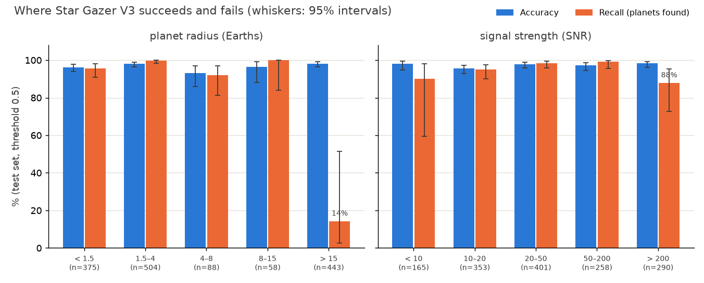
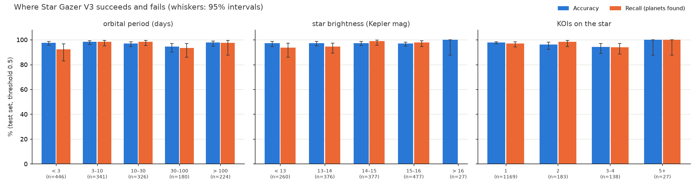

# Data analysis: where Star Gazer V3 succeeds and fails

The headline (97.2% accuracy, AUC 0.994) is an average over 1,517 test KOIs on stars never seen in training.
This page breaks it down to show where the model is strong and where it isn't. Produced by
`scripts/experiments/analyze_results.py` from the saved test predictions, the NASA KOI catalog and the candidate
scores. Numbers are in `results/v3_public/analysis.json`.

Every slice below shows its size (n) and 95% intervals. A slice with a few dozen KOIs can swing by 10 points
by chance, so the intervals matter more than the bar height.

## By planet size and signal strength

| Planet radius (Earths) | KOIs | Real planets | Accuracy | Recall (planets found) | False positives called planets |
|---|---|---|---|---|---|
| < 1.5 (Earth-sized) | 375 | 140 | 96.3% | 95.7% | 3.4% |
| 1.5–4 (super-Earths, sub-Neptunes) | 504 | 331 | 98.0% | **99.7%** | 5.2% |
| 4–8 | 88 | 50 | 93.2% | 92.0% | 5.3% |
| 8–15 (Saturn to Jupiter) | 58 | 20 | 96.6% | 100% | 5.3% |
| **> 15** | 443 | **7** | 98.2% | **14%** (1 of 7; interval 3–51%) | 0.5% |

**The clearest weakness: giant objects.** Above 15 Earth radii, 436 of 443 test KOIs are false positives: almost
anything that big is really a small star (an eclipsing binary). Star Gazer learned that, so it is excellent at
rejecting them (0.5% wrongly called planets) but finds only 1 of the 7 real giant planets in this range. The
same pattern showed up independently in the [TESS test](EXPERIMENTS_V3.md), where large Kepler planets were
the ones most often missed. Signal strength tells the same story: recall drops to 88% (interval 73–95%) for
the very deepest transits (SNR above 200), which also resemble eclipsing binaries.

**The strength: small planets.** Earth-sized and super-Earth candidates, the scientifically exciting ones, are
found 96–100% of the time.

## By orbital period, star brightness and planets per star

| Slice | Weakest group | Note |
|---|---|---|
| Orbital period | 30–100 days: 94.4% accuracy (n = 180) | Every group is 92–99% recall; long-period planets (> 100 days, few transits) are found 97.6% of the time thanks to using all Kepler quarters |
| Star brightness | none stands out | 96.9–97.4% accuracy from bright (< 13 mag) to faint (15–16 mag) stars |
| KOIs on the star | stars with 2 KOIs: 8.9% of their false positives called planets (n = 56) | Matches the [audit](AUDIT_V3.md)'s note that multi-KOI systems were confirmed in bulk, so "more KOIs on the star" nudges the model towards "planet" |

## The most confident mistakes

| KOI | Truth | P(planet) | Radius (Earths) | SNR | Likely reason |
|---|---|---|---|---|---|
| K00245.04 | planet | 0.0001 | (missing) | (missing) | No transit fit in the catalog: missing values look like a false positive's |
| K00377.02 | planet | 0.001 | 8.0 | 366 | Very deep, strong transit (Kepler-9 system): binary-like |
| K01334.02 | false positive | 0.998 | 1.9 | 25 | Looks exactly like a small planet |
| K01712.01 | false positive | 0.995 | 2.7 | 37 | Same |
| K06104.01 | false positive | 0.988 | 2.4 | 21 | Same |
| K01236.04 | planet | 0.028 | 4.1 | 31 | |
| K07036.01 | false positive | 0.972 | 0.6 | 15 | |
| **K00013.01** (Kepler-13 b) | planet | 0.031 | 21.4 | 4,062 | A giant planet around a hot star in a binary system: the textbook hard case |
| K04424.01 | planet | 0.032 | 1.0 | 13 | Weak signal |
| K02651.01 | false positive | 0.965 | 2.4 | 24 | |

Most confident false alarms are small, planet-like signals that NASA rejected for reasons outside the light
curve. Typical reasons are contamination from a nearby star, which needs pixel-level data, or follow-up
observations. Star Gazer can't see either. Most confident misses are giant or very deep signals.

## The 1,976 unconfirmed candidates

| | Count |
|---|---|
| Called planets (≥ 0.70, Star Gazer's threshold) | 737 (37%) |
| Confident planets (≥ 0.9) | 525 |
| Confident false positives (< 0.1) | 805 |
| Genuinely uncertain (0.3–0.7) | 274 |
| Agreement with NASA's own vetting score (where it exists) | 61% (correlation 0.39) |

Candidates are, by definition, the cases nobody has settled, so the lower agreement with NASA here is expected
(on the decided test set the two agree far more). The [scoreboard](../results/scoreboard/) will show over time
which of the two was right.

## What this means for V4

1. **Giant planets:** add more confirmed giant planets (and hot-star hosts) to training, or weight them more,
   so "big" stops meaning "binary" by default.
2. **Missing catalog values:** add explicit "value was missing" inputs, so a missing fit isn't silently read as
   evidence of a false positive.
3. **Contamination:** the confident false alarms point to pixel-level information (difference images) as
   the next useful input.
4. Re-check each change with cross-validation on fresh splits, not this test set (see the
   [audit](AUDIT_V3.md)).
