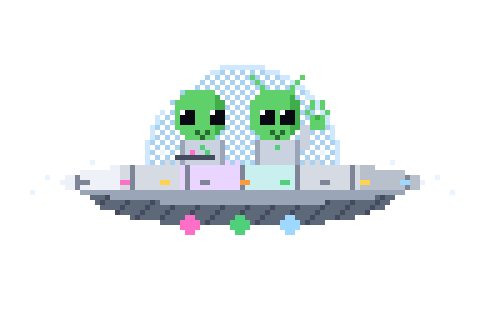

# Plan: achievements v2: chapters, real constellations, new easter eggs and sky events

**Status: plan only (local branch `plan/constellations`).** Builds on CONSTELLATIONS.md (the data) and replaces
its pairing table: the achievement list is reorganised first, then every chapter gets a real constellation with
exactly as many stars as it has achievements. Concept art: `pixel-art/concepts/` (`scripts/starmap/draft_concepts.py`);
references: `pixel-art/references/concepts/`.

## 1. New easter eggs

### A. Our planets up close
Searching **mercury, venus, mars, jupiter, saturn, uranus, neptune, pluto** or **moon** opens that world on its own:
the big pixel planet turning (the art already exists, `pixel-art/solar-system/`), its moons orbiting, the real
NASA photo beside it (already in `web/gallery/`), and a few facts (size, day, year, moons, a "did you know").
Each is a Galleria card (10 more eggs: 34 in all). Needs: a pixel Moon (grey, craters), a "planet card" scene.

### B. Project Hail Mary (Andy Weir's 2021 novel and its 2026 film)
Spoiler-marked, original pixel art only (no film images), real astronomy underneath:
| Search | What opens | Real facts shown |
|---|---|---|
| `tau ceti`, `hail mary`, `project hail mary`, `astrophage` | **HAIL MARY** card: Tau Ceti, a ship, and a five-legged friend talking in chords (concept: `draft_hail_mary.gif`) | Tau Ceti: a Sun-like star 11.9 light-years away in Cetus; candidate planets found by radial velocity (2017), not confirmed. The book's idea fits this map: Astrophage makes stars *dim*, and dimming stars is exactly what Kepler measured |
| `erid`, `40 eridani`, `rocky`, `eridian`, `fist my bump` (**secret**) | **ERID** card | 40 Eridani: a triple star 16.3 light-years away (an orange dwarf, a white dwarf and a red dwarf); a planet claimed in 2018 was later put down to the star's activity. (It's also where Star Trek put Vulcan.) |
Neither star is in Kepler's field, so the cards show where they are on the sky instead (Cetus, Eridanus),
using the star positions from the constellation data.

### C. "What the alien doing" (secret)
Two green aliens in a flying saucer: one driving, one throwing a ✌, the saucer bobbing, rim lights chasing,
a tractor beam flickering (concept, archived: `pixel-art/archive/concepts/draft_aliens_2_until-2026-10-18_3c514a8.gif`). Found by searching **aliens, ufo, flying saucer,
little green men, what the alien doing**, or by clicking the saucer when it (rarely) zooms across the map.

### D. Sky events: comets, asteroids, the odd UFO
Every few minutes something crosses the map: a **comet** (ion tail and dust tail, `draft_comet_v3.gif`; built in v1.1.0) or a
tumbling **asteroid** (`draft_asteroid_v2.gif`). Very rarely, after you've been around a while, the **saucer**.
Click one while it's on screen to catch it. Light on power: drawn with the map (~8 fps), never while the
page is idle or hidden, off with reduced motion, rarer in battery-saver mode.

## 2. New achievements (35), all with data or features we already have

| Chapter | New | How | Data / feasibility |
|---|---|---|---|
| Launch | TAKE THE TOUR / SHUTTERBUG | Finish the first-visit tour / download your star card | events exist |
| Worlds | WATER WORLD? / TWIN HABITATS / ELDER SYSTEM | Visit Kepler-22 / Kepler-62 / Kepler-444 | on the map |
| Record breakers | SPEED DEMON / DEEP FREEZE / FURNACE / HEAVYWEIGHT / GIANT STAR / TINY STAR / FAR SHORE / NEXT DOOR | Visit the system with the shortest year / coldest planet / hottest planet / most massive planet / biggest star / smallest star / most distant / nearest | export works out these records from the KOI and NASA tables |
| Home | NEIGHBOUR / MOONWALKER / RINGMASTER / KING OF PLANETS / PLANETARY TOUR | Look up any planet / the Moon / Saturn / Jupiter / all nine worlds | new planet cards |
| Fleet | HALFWAY THERE / HOME SYSTEM / EGG HUNTER | 12 easter eggs / the Solar System, Pluto, the ISS and Kepler / 6 eggs | existing eggs |
| Beyond | HAIL MARY | Search Tau Ceti | new card |
| Rituals | TEN MYSTERIES / MONTH OF MYSTERIES / REGULAR / DEVOTED / PERSEIDS / GEMINIDS / FULL MOON / SOLSTICE / EQUINOX | 10 daily mysteries / 30-day streak / visit on 7 / 30 different days / visit 11-13 Aug / 13-14 Dec / on a full moon (worked out from the Moon's 29.53-day cycle) / on a solstice / an equinox | dates only |
| Sky watch | COMET CATCHER / ROCK HOUND / TAIL CHASER / UFO SPOTTER | Click a passing comet / asteroid / 5 comets / the saucer | new sky events |
| Secrets | FIST MY BUMP / WHAT THE ALIEN DOING / RETRO | Find Erid / the aliens / the Konami code (↑↑↓↓←→←→BA) turns the map into a green CRT | new cards |

57 today + 35 = **92**. Existing achievements keep their ids (nobody loses anything); some move chapter.

## 3. Chapters: a better order, a journey (each one a real constellation)

The Achievements tab reads like Kepler's own story, from first look to the whole sky:

| # | Chapter | Achievements | Constellation (stars) | Why |
|---|---|---|---|---|
| 1 | LAUNCH | 7: first light, dice, shared link, next planets, first easter egg, tour, star card | **Ursa Minor** (7) | Polaris, the first star to find |
| 2 | THE FIELD | 7: depth, CCDs, eagle eye, cartographer, highlighter, sky photo, eco mode | **The Big Dipper** (7, in Ursa Major) | its pointers find Polaris: the map's tools |
| 3 | WORLDS | 9: the six famous worlds + Kepler-22, -62, -444 | **Cygnus** (9) | Kepler's own field |
| 4 | SCIENCE | 7: goldilocks, double stars, lava world, ancient light, flares, transit, true scale | **Corona Borealis** (7) | T CrB, the nova everyone is waiting for |
| 5 | RECORD BREAKERS | 8 new records | **Aquila** (8) | Altair spins once every 9 hours |
| 6 | HOME | 5 planet lookups | **Cassiopeia** (5) | the queen above home |
| 7 | FLEET | 12: spacecraft eggs and collections | **Gemini** (12) | NASA's Gemini program |
| 8 | BEYOND | 3: Tatooine, double sunset, Hail Mary | **Triangulum** (3) | three distant suns |
| 9 | ORACLE | 9: Star Gazer's guesses + predictions | **Leo** (9) | it takes courage to call it |
| 10 | RITUALS | 11: daily mysteries, return visits, sky events | **Canis Major** (11) | Sirius's rising set Egypt's calendar |
| 11 | SKY WATCH | 4: catching comets, asteroids, the UFO | **Sagitta** (4) | the Arrow: things streaking by |
| 12 | SECRETS | 9: the six secrets + Erid, aliens, retro | **Monoceros** (9) | the Unicorn: it's hard to find |
| 13 | LEGEND | TRUE STAR GAZER | **the whole sky** | every completed figure on one chart |

All 13 figures come from the d3-celestial data (star counts checked). In each figure the **brightest star is
the chapter's hardest achievement**, lines light between earned stars, and a finished chapter glows with its
name. Hovering a star names it ("Polaris (α UMi) · FIRST LIGHT").

## 4. Rewards: different actions, different prizes

| Earned | Reward |
|---|---|
| Each achievement | its trophy (by difficulty), a star in its constellation, progress toward your star's next stage |
| Each chapter | its badge, and an unlock: LAUNCH a header title (CADET); THE FIELD an **infrared** map palette; WORLDS extra planet facts on hover; SCIENCE true star colours mode; FLEET Kepler flies across the map now and then; HOME an orrery view of the Solar System; ORACLE a gold hologram skin; RITUALS a streak flame on the daily card; SKY WATCH more frequent comets; SECRETS the retro CRT palette; LEGEND "Gaze mode" |
| Rank stages | titles under the emblem: CADET → OBSERVER → NAVIGATOR → ASTRONOMER → ASTROPHYSICIST → STAR GAZER |
| Every action | a small "+1 STAR SEEN" counter for TRUE STAR GAZER, so every click moves something |

Unlocks are switches in Settings (any combination), so nothing is forced on anyone.

## 5. Build order

1. Chapters + real constellations (`make_constellations.py` -> `web/data/constellations.js`), regrouping the 57.
2. Planet cards and the Moon (HOME), record breakers (export), the Fleet/World additions.
3. Hail Mary, Erid and the aliens (cards and art), sky events (comets, asteroids, rare UFO).
4. Rituals (dates, moon phase), rewards and unlocks, titles.
5. Docs, tests (each figure has exactly its chapter's number of stars; ids never change), concept art -> site art.

## 6. Decisions for you

**Answered 18 October 2026:**
1. Keep the 13 chapters and their constellations.
2. Keep all 35 new achievements.
3. Hail Mary: **no spoiler warning** (those who know the book and film will find it); the Erid egg stays secret.
4. Sky events: as answered in SKY_EVENTS_DRAFTS.md.
5. Rewards, in order of priority: **titles, the orrery, Kepler fly-bys, colour palettes**.

The questions as first asked:

1. The 13 chapters and their constellations: keep, or swap any?
2. The 35 new achievements: all, or trim some (e.g. the sky-event dates)?
3. Hail Mary: spoiler warning on, and is the Erid egg secret (as planned)?
4. Sky events: how often? (Plan: a comet or asteroid every 3 to 6 minutes of active use; the UFO about once an hour.)
5. Rewards: which unlocks matter most to you (palettes, titles, orrery, Kepler fly-bys)?
