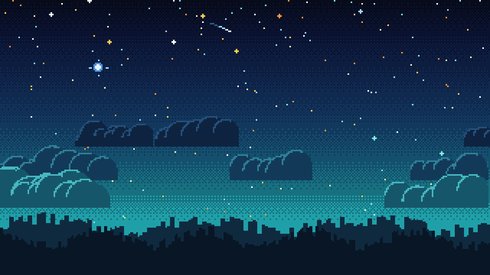

# Plan: a pixel night-sky page background

**Status: built (October 2026): `web/src/55-backdrop.js`, with a Background setting (animated / still / plain).**
The user wants the page's plain dark-purple background (`--bg: #070b1a` on `body`) replaced by an animated
pixel-art night sky, inspired by a screenshot they shared (someone else's art: inspiration only, never copied
or committed). Concept: `pixel-art/concepts/draft_background.gif` (`scripts/starmap/draft_concepts.py`, `background()`).

## What it looks like (top to bottom)

| Layer | Look | Moves? |
|---|---|---|
| Sky | 8 bands from near-black navy (#070b1a) to teal (#1fa0a8) at the horizon, blended with a 4x4 Bayer dither (pixel art, no smooth gradients) | no |
| Stars | ~260 multicoloured dots (white, pale yellow, ice blue, gold, orange, mint), a few as small crosses, thinning toward the horizon | twinkle |
| One bright blue star | a glowing star with a 4-point spark, e.g. Deneb (the Kepler field is in Cygnus) | slow pulse |
| Shooting stars | a white-to-blue streak every few seconds | yes |
| Clouds | 3 layers of puffy, flat-bottomed clouds (navy far, teal near) with lit rims | drift sideways, nearer = faster (parallax) |
| Tree line | two dark layers of a ragged forest edge along the bottom of the page | no |

Later, tie-ins with ACHIEVEMENTS_V2.md: the comets, asteroids and the UFO from "sky events" can fly across this
background too, and alternative skies (dawn, aurora, Mars) can be chapter rewards.

## How to build it

1. **A fixed canvas behind the page** (`<canvas id="backdrop">`, `position: fixed; inset: 0; z-index: -1;
   pointer-events: none; image-rendering: pixelated`), drawn at a low internal size (about 320 px wide, height
   from the window's aspect) and scaled up, so it is cheap and crisp.
2. **Static layers drawn once** into off-screen canvases (sky gradient, each cloud layer, trees), redrawn only
   on resize. Each frame only composes them (cloud offsets) and adds stars and shooting stars: a few hundred
   pixel writes.
3. **Animation in the existing loop** (`web/src/60-loop.js`): drawn at the map's ~8 fps cadence, so it follows
   the animation menu (off = one still frame), stops when the page is idle or hidden, and is a still image with
   `prefers-reduced-motion`. No extra timers.
4. **New part** `web/src/55-backdrop.js` (drawing) + `index.html` canvas + CSS; `body` keeps a CSS gradient as a
   fallback without JavaScript.
5. **Readability:** panels get a slightly see-through background (`--panel` at ~92%) so the sky shows at the
   edges; header text gets a 1 px dark text shadow; re-check contrast (tests/test_palette.py).
6. **Phones:** fewer stars and two cloud layers below 600 px.
7. **Settings:** "Background: night sky (animated) / night sky (still) / plain" (saved with the progress).
8. **Tests:** the canvas exists and draws; reduced motion -> no animation; no page errors; the map and dialogs
   still clickable (pointer-events none).

Effort: about half a day. Risk: low (purely visual, behind everything).
