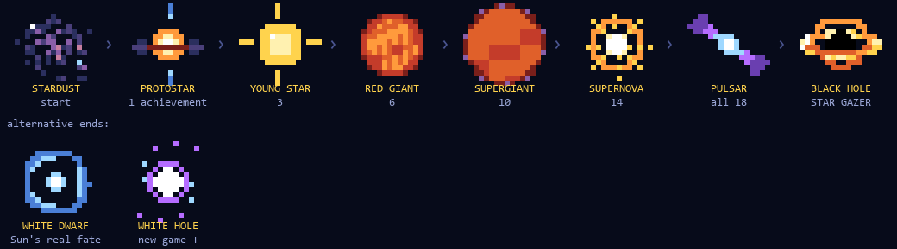
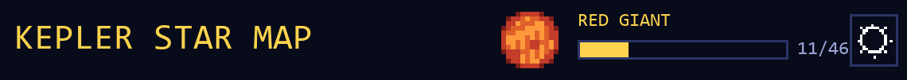

# The Star Gazer mission and rank emblems (design)

**Status: built (October 2026)** with the recommended choices: every system on the map, the staged reveal, the black-hole emblem and title, the white dwarf as an alternative final emblem and the white hole after a reset (web/src/49-ranks.js). This is the long-term endgame for the star map's Galleria
([EASTER_EGGS.md](EASTER_EGGS.md)): a final secret mission, a rank emblem that grows through the life of a
star, and an achievements bar at the top of the page. Concept pixel art is in
[`pixel-art/emblems/`](../../pixel-art/emblems) (made by `scripts/starmap/draft_emblems.py`); the official
pictures each stage is based on are in [`pixel-art/references/stars/`](../../pixel-art/references/stars)
(sources in [SOURCES.md](../../pixel-art/references/SOURCES.md)).

## 1. The final mission: TRUE STAR GAZER

The project is called Star Gazer, so the last title should go to people who really did gaze at the stars:
not just stay on the page, but **open every star system on the map**: all 3,611 today (drawn systems,
unconfirmed ones and the "soon to cross the stars" ones all count).

**How it looks.** A secret mission with its own colour (violet, like the map's highlight, with a slow shimmer),
apart from the regular achievements. Before it is earned it shows a single clue:

> *Only those who look upon every star…*

It reveals itself in steps, so it feels like a mystery rather than a chore list:

| Systems opened | What the mission card shows |
|---|---|
| 0–99 | Only the clue, as `???` |
| 100 | A faint violet progress bar appears: `100 / 3,611` |
| 1,806 (half) | The second half of the riddle: *"…and leave none unseen."* |
| 3,500 | The map's **UNSEEN** highlight turns on by itself, to find the last ones |
| all | Unlocked |

**The moment it unlocks.** Every star on the map flashes violet in a wave from the centre out, the rank
emblem collapses into the black hole, and the pop-up (violet, longer than usual) says:

> **TRUE STAR GAZER**
> *Only those who dare look beyond the stars may call themselves true Star Gazers.*

**Rewards** (pick one or more):
- the **BLACK HOLE** emblem, the last stage of the ladder (section 2);
- the title **STAR GAZER** next to the emblem in the header;
- a downloadable **pixel certificate** (a PNG drawn in the browser) with the date and "3,611 / 3,611";
- a **Gaze mode** map palette: every star twinkles in its real temperature colour.

**Making it possible, not just long.** 3,611 systems at a few seconds each is roughly four hours: a real
goal, but only fun with help:
- a new highlight chip, **UNSEEN**, that lights up the systems you haven't opened yet (and dims the rest);
- the arrow keys already hop from star to star, so you can sweep the map without the mouse;
- the system list keeps growing with the monthly NASA refresh, so the count is "every star on the map
  today"; new stars added later reopen the mission as *"New stars have appeared…"* without taking the
  title away.

**Storage.** The visited systems are kept as Kepler IDs (stable across data refreshes) in the browser's
local storage, about 25 KB for all 3,611; nothing leaves the browser.

## 2. Rank emblems: the life of a star

Your emblem is a star that grows up as you collect achievements. It sits at the top of the page next to the
⚙ button and every stage moves, like the concept GIFs: stardust twinkles, the protostar's jets flicker, the young
star's rays pulse, the red giant's surface boils, the supergiant breathes, the supernova blasts outward, the pulsar
sweeps its beams and the black hole's disk turns. The harder (epic and secret) achievements have unique trophies:
the cup carries a symbol of what they're for (Mars, Jupiter, the Golden Record, a rocket, "zZ"...).

| # | Emblem | Reached at | What the stage is | Reference |
|---|---|---|---|---|
| 0 | STARDUST | start | A cold cloud of gas and dust: every star begins in one | Carina Nebula pillars (Spitzer) |
| 1 | PROTOSTAR | 1 achievement | A ball of gas collapsing and heating up, wrapped in a dusty disk, firing jets from its poles | A flaring protostar in Orion (Spitzer) |
| 2 | YOUNG STAR | 5 | Hydrogen fusion has begun: a main-sequence star like the Sun, where stars spend 90% of their lives | The Sun (SDO) |
| 3 | RED GIANT | 10 | The core's hydrogen runs low and the star swells up to hundreds of times its size | Mira and its 13-light-year tail (GALEX) |
| 4 | SUPERGIANT | 18 | A massive star, swollen even more, shedding dust (like Betelgeuse) | (same family as Mira) |
| 5 | SUPERNOVA | 28 | The core collapses and the star explodes, briefly outshining its galaxy | **Kepler's Supernova**, seen by Johannes Kepler in 1604 (Chandra) |
| 6 | PULSAR | 40 achievements | What's left: a city-sized neutron star spinning many times a second, sweeping beams across space | Pulsar (artist concept) |
| 7 | BLACK HOLE | TRUE STAR GAZER | Gravity wins: not even light escapes. The ring of light around the shadow is real: the Event Horizon Telescope photographed one in 2019 | Black hole disk (artist concept); M87 with the first black-hole image |

**Rank-up moment:** a pop-up like *"YOUR STAR EVOLVED · RED GIANT → SUPERGIANT"*, with the new emblem
animating once.

**Science note (shown on the ranks page).** Real stars take one of two roads. A star like the Sun becomes a
red giant, puffs off its outer layers as a planetary nebula, and ends as a **white dwarf**. Only stars more
than about eight times heavier than the Sun become supergiants and explode, leaving a **neutron star** or,
for the heaviest, a **black hole**. The ladder follows the heavy road so it can end in a black hole.

**Alternative ends (choose one or both):**
- **WHITE DWARF**, the Sun's real fate: an alternate final emblem you can switch to in Settings once you've
  earned the black hole, for people who prefer the true story of our own star. Reference: the Helix Nebula
  and a white dwarf (Spitzer, artist concept).
- **WHITE HOLE**, *new game +*: after TRUE STAR GAZER, resetting progress turns your emblem into a white hole,
  the theorised time-reverse of a black hole, where nothing can fall in and everything comes out. You start
  over, but your emblem remembers. White holes are a solution of Einstein's equations that has never been
  observed, so the card says so; there is no photo of one.

## 3. The achievements bar

A thin bar in the header, beside the emblem: the rank's name above it, `11/46` after it. Clicking it opens the
Galleria on the ACHIEVEMENTS tab. On phones it shrinks to the emblem and the count. Inside the Achievements
tab, a bigger version shows how many achievements are left until the next stage, and the whole ladder with
the stages still to come as silhouettes (like the easter eggs).

## 4. Achievements

There are now 46 (built; the full list is in [EASTER_EGGS.md](EASTER_EGGS.md)), so the ladder's thresholds
are 1, 5, 10, 18, 28 and 40; the last six can be any, so the secret ones are a bonus rather than a wall.
TATOOINE (Kepler-16) and PROPHET (a candidate NASA later confirms) are still ideas.

## 5. Decisions for you

1. **Final requirement:** every system (3,611, about four hours), or every *drawn* system (fewer, quicker)?
2. **Reveal steps** as in the table, or keep the mission fully secret until it's earned?
3. **Reward:** black hole emblem + title (recommended), plus the certificate and/or Gaze mode?
4. **Ladder:** the heavy-star road to a black hole (recommended), with the white dwarf and/or white hole as
   alternative ends?
5. **Thresholds:** 1, 5, 10, 18, 28, 40 as above, or should secrets count?
6. **Emblem size:** 16 × 16 pixels as drafted (the black hole is tight at that size), or 24 × 24?

## Files

| Path | What |
|---|---|
| `pixel-art/emblems/draft_<stage>.png` | Each emblem, 16 × 16 pixels enlarged 10× |
| `pixel-art/emblems/draft_<stage>.gif` | The moving ones, animated |
| `pixel-art/emblems/draft_ladder.png` | The ladder with the alternative ends |
| `pixel-art/emblems/draft_header.png` | The header with the emblem and the achievements bar |
| `pixel-art/references/stars/` | The NASA pictures behind each stage |
| `scripts/starmap/draft_emblems.py` | Draws the drafts; tweak shapes and colours there |
