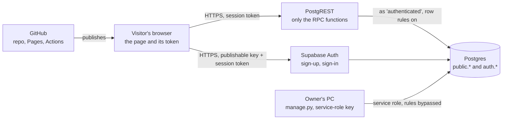
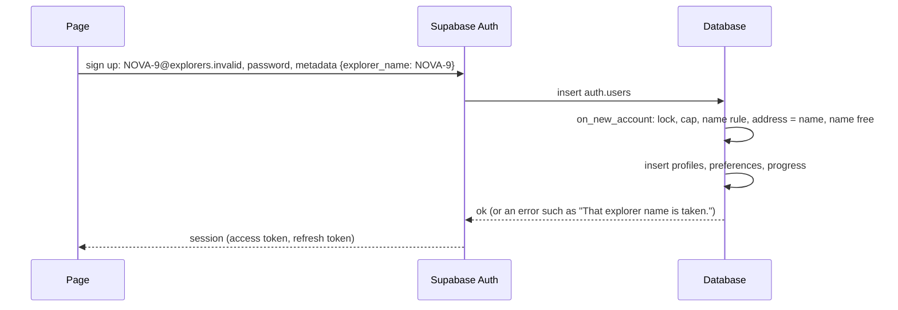
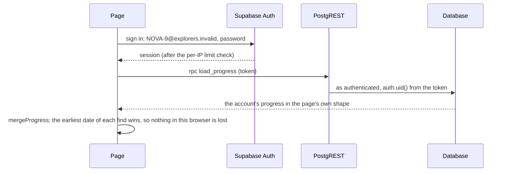

# Threat model and launch checklist: the Explorer Registry

Written 27 November 2026 (Platform queue, step 10). It covers the player accounts in `supabase/` and the page's
side of them (`web/`). **Nothing here is online yet**: the database runs only on the owner's PC (local Supabase in
Docker), and the page's forms send nothing. This document says what could go wrong once it is online, what
already stops it, and what must be done before going online. The go-online checklist at the end is written, not
done.

Every "done" below points to the code or test that does it. If a claim here stops being true, fix the claim or
the code in the same change.

## 1. What there is to protect

| Asset | Where | Why it matters |
|---|---|---|
| Each explorer's progress (finds with dates, calls, settings) | `public.finds`, `public.progress`, `public.preferences` | the reason accounts exist; losing or corrupting it is the main harm |
| Sign-in secrets: password hashes, sessions, refresh tokens | `auth.*` (Supabase Auth) | a stolen session or cracked password is a taken-over account |
| The service-role key | the owner's PC only (`supabase status`, later the hosting dashboard) | it bypasses every row rule: whoever holds it owns the database |
| Roles (player, tester) and the audit log | `public.profiles.role`, `public.audit_log` | a self-made tester would see tester-only previews; the log is how changes are traced |
| Backups | `.secrets/db-backups/` (git-ignored, refused by the commit hooks) | they hold password hashes |
| The page itself | GitHub Pages, `web/` | a script injected into the page could act as any signed-in visitor |
| Visitors' privacy | everywhere | the project promises no email, no real names, no tracking |

There is no email address, real name, payment detail or location anywhere, by design: the sign-in address is
`<name>@explorers.invalid` (`.invalid` never delivers mail) and the database refuses anything else.

## 2. Who might attack, and how

| Actor | Can | Wants |
|---|---|---|
| Anyone on the internet | load the page, call the public API with the public (publishable) key, sign up | free storage, a defaced page, other people's progress, a crashed service |
| A signed-in explorer | everything above, plus the account's own database functions | to edit its own record past the rules (fake finds, tester role), or reach other accounts |
| A script injected into the page (a cross-site scripting bug) | whatever the signed-in visitor can | the visitor's session token |
| Someone with the owner's laptop, GitHub or hosting account | the service-role key, the backups, the published page | everything |
| A compromised dependency (an npm or Python package, a GitHub Action) | code running in CI or on the owner's PC | keys, a poisoned release |

## 3. Trust boundaries



Everything left of PostgREST is untrusted: the page's checks are for the player's convenience, the database's
checks are the real ones.

## 4. Threats and what stops them

Status: **done** (built and tested), **at launch** (a setting or step on the checklist), **accepted** (a known,
small risk, written down).

| # | Threat | What stops it | Status |
|---|---|---|---|
| T1 | An explorer reads or changes another account | row-level security: each table allows `select` of the account's own rows only; all direct writes revoked; every write goes through a `security definer` function keyed on `auth.uid()` (`20261117000000_accounts.sql`) | done; pgTAP "privacy" tests |
| T2 | An explorer writes junk or oversized progress | `save_progress` checks the payload's type and size (250 KB), known keys only, each typed and size-limited; `progress.data` capped at 200 KB | done; pgTAP |
| T3 | Fake achievements or easter eggs | finds must name an id in `public.catalog` (foreign key; unknown ids in a save are skipped), at most 300 per kind per account, dates between 2026 and tomorrow, the earliest date kept | done (`20261128000000_catalog.sql`, `20261128000200_finds_use_catalog.sql`); pgTAP. An explorer can still claim real ids it never earned: accepted (no prizes, nothing competitive) |
| T4 | An explorer makes itself a tester | `role` is not writable by players; `set_role` runs only as the service role, is limited to `max_testers`, and is logged | done; pgTAP |
| T5 | A real email or phone is attached to an account | the sign-up trigger accepts only `<name>@explorers.invalid`; `keep_explorer_identity` refuses any later email or phone change | done (`20261128010000_explorers.sql`); pgTAP |
| T6 | Password guessing | 12 characters minimum; Supabase Auth's limit of 20 sign-in and sign-up requests per 5 minutes per IP (`supabase/config.toml`); bcrypt hashes | done locally; **at launch**: set the same values on the hosted project, consider a CAPTCHA |
| T7 | Mass sign-ups filling the database | the per-IP limit above, plus a hard cap of `max_accounts` (200) checked under a lock at sign-up | done; pgTAP. **At launch**: a CAPTCHA if sign-ups are abused |
| T8 | Saving in a loop to load the database | one save per `save_gap` (5 seconds) per account, also for reset | done; pgTAP |
| T9 | Stealing a session token through an injected script | strict Content Security Policy (own scripts only, no inline code), every value escaped with `esc()`, tests that fail if either loosens (`tests/test_web_data.py`); tokens expire after an hour | done for the page today. **At launch**: keep the token in `sessionStorage` unless the player ticks "keep me signed in", and add `connect-src` for the Supabase address only |
| T10 | Progress loaded from the account carrying a script | the page reads it with the same tolerant reader as a backup file (`mergeProgress`: ids and dates checked by pattern) and escapes everything it shows | done (the reader); the sync code is not written yet |
| T11 | Cross-site request forgery | not applicable: the token travels in a request header, never a cookie | not applicable |
| T12 | The service-role key leaks | never in the page or the repository; the commit hooks and CI refuse secret files (`.claude/hooks/`, `tests/test_repo_hygiene.py`); a leak scan before each push | done. **At launch**: the hosted key lives only in the owner's password manager; rotate it if ever exposed |
| T13 | A backup leaks | backups live in `.secrets/`, git-ignored and refused by the hooks; they leave out sessions and tokens | done |
| T14 | Name enumeration ("that explorer name is taken") | names are public by nature (made-up, no personal details) | accepted |
| T15 | A deleted account keeps working | `delete_my_account` removes the `auth.users` row, and everything else follows by cascade; an already-issued token lasts until it expires (at most an hour) but finds no rows | done; pgTAP. Accepted: the one-hour tail |
| T16 | Losing everyone's progress | the database is in a Docker volume (survives `supabase stop`); `manage.py backup` before any reset; `restore` checks the file and saves the current state first; old backups upgrade on restore | done locally. **At launch**: the host's daily backups plus a weekly `backup` kept offline |
| T17 | A poisoned dependency or Action | Actions pinned to commit SHAs, Python dependencies hash-locked, the Supabase CLI pinned to one version, Dependabot for updates, CodeQL and Scorecard in CI | done |
| T18 | The owner's accounts are taken over | two-step sign-in on GitHub; the hosting account gets it too | **at launch** (hosting); GitHub: check |
| T19 | Privacy promises broken quietly | no analytics, no third-party scripts (the policy forbids them), the landing page's claims checked against the code | done |

## 5. How the main flows work

These are the flows as built in the database, with the page's side as planned (the sync code in the page is not
written yet).

### Sign up



### Sign in and load



### Save

```mermaid
sequenceDiagram
  participant P as Page
  participant R as PostgREST
  participant D as Database
  P->>R: rpc save_progress(the merged progress)
  R->>D: save_progress as authenticated
  D->>D: signed in? size and type? not within save_gap of the last save?
  D->>D: finds: catalog ids only, at most 300, the earliest date kept
  D->>D: preferences: valid values only; the rest: known keys, typed, merged
  D-->>P: the save time (or "Saving too often." - the page tries again later)
```

### Delete

```mermaid
sequenceDiagram
  participant P as Page
  participant R as PostgREST
  participant D as Database
  P->>R: rpc delete_my_account (token), after the player confirms
  R->>D: delete auth.users where id = auth.uid()
  D->>D: profiles, preferences, finds, progress go by cascade
  D-->>P: ok; the page signs out (progress stays in this browser unless the player resets it)
```

## 6. Go-online checklist (written, not done)

Do these in order, and only after the user decides to go online.

- [ ] Create the hosted Supabase project (region near the players), owner account with two-step sign-in.
- [ ] Push the migrations (`supabase db push`), then run the pgTAP tests against it.
- [ ] Auth settings as in `supabase/config.toml`: sign-up on, email confirmations off, anonymous sign-ins off,
      minimum password 12, the per-IP sign-in and sign-up limit, the site address as the only redirect.
- [ ] Turn off every service the game doesn't use (storage, realtime, edge functions).
- [ ] The publishable key in the page; the service-role key only in the owner's password manager.
- [ ] The page's Content Security Policy gains `connect-src` for the project's address only; the policy test
      updated to allow exactly that and nothing else.
- [ ] Session token in `sessionStorage` by default; "keep me signed in" opt-in.
- [ ] Terms of Use 1.2 (the accounts section) and the privacy lines on the landing page checked word by word
      against what is built; SECURITY.md's scope table gains the accounts.
- [ ] Backups: the host's daily backups on; a weekly `manage.py backup` copy kept offline; one restore rehearsed.
- [ ] A CAPTCHA on sign-up ready to switch on if sign-ups are abused.
- [ ] The tester account recreated on the hosted project; its password in the password manager.
- [ ] A release with "New:" notes only (no security details), then watch the first week's sign-ups and errors.
